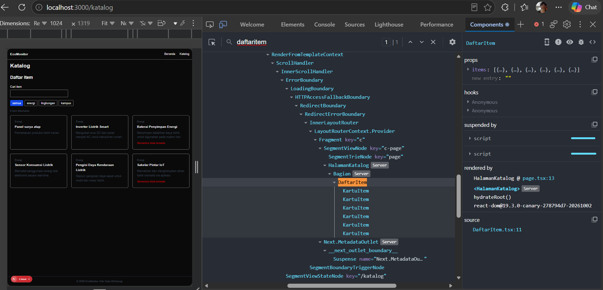
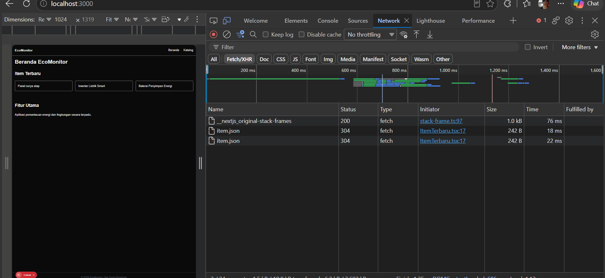

# Dokumen Teknis Modul 3 TypeScript dan Komponen React

**Nama:** Samuel Reinaldo Sebastian Sianturi  
**NIM:** 105224013  
**Repositori:** https://github.com/samuelreinaldo12/105224013_Samuel_PemwebW1  

---

## 1. Tipe Data Produk

Pengdefinisan tipe entitas produk disimpan pada berkas `lib/tipe.ts` menggunakan kombinasi `interface`, `type alias`, *union type*, dan *optional property*.

```typescript
export type Kategori = "energi" | "lingkungan" | "kampus";

export interface Item {
  id: number;
  judul: string;
  kategori: Kategori;
  deskripsi: string;
  tersedia: boolean;
  gambar?: string;
}
```

Alasan Pemilihan Union Type dan Optional Property:
* **Union Type (`Kategori`):** Mengunci nilai properti `kategori` hanya pada tiga pilihan string yang valid (`"energi" | "lingkungan" | "kampus"`). Hal ini mencegah kesalahan penulisan (*typo*) serta penugasan kategori yang tidak terdaftar saat proses kompilasi.
* **Optional Property (`gambar?`):** Digunakan tanda tanya (`?`) karena tidak semua entitas item memiliki aset gambar saat pendaftaran awal. Properti ini boleh bernilai `undefined` tanpa memicu galat kompilator.

## 2. Struktur Komponen

Aplikasi menggunakan arsitektur pemisahan antara **Server Component** (untuk *rendering* halaman cepat tanpa mengirim JavaScript berlebih) dan **Client Component** (untuk komponen interaktif dengan *state* dan *event listener*).

### Diagram Pohon Komponen

```text
RootLayout (app/layout.tsx) [Server Component]
├── SiteHeader [Server Component] (props: namaProduk, tautan)
├── {children} (Halaman Aktif)
│   ├── Halaman Beranda (app/page.tsx) [Server Component]
│   │   ├── Bagian (props: id, judul, children) [Server Component]
│   │   │   └── ItemTerbaru [Client Component] ("use client")
│   │   └── Bagian (props: id, judul, children) [Server Component]
│   │       └── Fitur Utama
│   └── Halaman Katalog (app/katalog/page.tsx) [Server Component]
│       └── Bagian (props: id, judul, children) [Server Component]
│           └── DaftarItem [Client Component] ("use client")
│               └── KartuItem (props: item) [Server Component / Client Child]
└── SiteFooter [Server Component] (props: namaProduk)
```

### Tabel Komponen

| Nama Komponen | Props & Tipe Data | Jenis Component | Tempat Penggunaan |
| :--- | :--- | :--- | :--- |
| `SiteHeader` | `namaProduk: string`, `tautan: Tautan[]` | Server Component | `app/layout.tsx` |
| `SiteFooter` | `namaProduk: string` | Server Component | `app/layout.tsx` |
| `Bagian` | `id: string`, `judul: string`, `children: React.ReactNode` | Server Component | `app/page.tsx`, `app/katalog/page.tsx` |
| `KartuItem` | `item: Item` | Server Component | `components/DaftarItem.tsx` |
| `DaftarItem` | `items: Item[]` | Client Component (`"use client"`) | `app/katalog/page.tsx` |
| `ItemTerbaru` | *(tanpa props)* | Client Component (`"use client"`) | `app/page.tsx` |

---

## 3. State dan Interaksi

Pada komponen `components/DaftarItem.tsx`, interaksi dilakukan menggunakan dua *state* interaktif:

```typescript
const [kataKunci, setKataKunci] = useState("");
const [filter, setFilter] = useState<Filter>("semua");
```

### Penjelasan Alur Event hingga Render Ulang:
1. **Input Pencarian (`onChange`):** Ketika pengguna mengetik kata kunci pada elemen `<input>`, *event handler* menangkap nilai `e.target.value` dan memanggil `setKataKunci()`.
2. **Tombol Filter (`onClick`):** Saat pengguna memilih salah satu tombol kategori, fungsi `setFilter(k)` dijalankan untuk memperbarui *state* `filter`.
3. **Pemicu Render Ulang (*Re-render*):** Pemanggilan fungsi pengubah *state* merender ulang komponen `DaftarItem`. Variabel `hasil` dihitung secara dinamis dari props `items` yang disaring berdasarkan `kataKunci` dan `filter` terbaru.
4. **Pembaharuan Tampilan:** Komponen `KartuItem` yang ditampilkan otomatis menyesuaikan dengan daftar `hasil` penyaringan, dan pembaca layar mendapatkan pembaruan jumlah via atribut `aria-live="polite"`.

### Bukti Tampilan Daftar Item



---

## 4. Pengambilan Data

Pengambilan data tiruan dilakukan pada komponen `components/ItemTerbaru.tsx` menggunakan `Fetch API` di dalam *hook* `useEffect`. Data diambil dari berkas statis `public/data/item.json`.

```typescript
useEffect(() => {
  let dibatalkan = false;
  async function muat() {
    try {
      const res = await fetch("/data/item.json");
      if (!res.ok) throw new Error(`HTTP ${res.status}`);
      const data: Item[] = await res.json();
      if (!dibatalkan) {
        setItems(data.slice(0, 3));
        setStatus("berhasil");
      }
    } catch {
      if (!dibatalkan) setStatus("gagal");
    }
  }
  muat();
  return () => { dibatalkan = true; };
}, []);
```

### Pengujian Kondisi Lifecycle:
* **Kondisi Memuat (*Loading*):** Saat pertama kali diakses, *state* `status` bernilai `"memuat"` dan menampilkan teks *"Memuat data..."*. Kondisi ini diverifikasi menggunakan pembatasan kecepatan jaringan (*Network Throttling*) "Slow 4G" pada DevTools.
* **Kondisi Berhasil (*Success*):** Ketika file `/data/item.json` sukses diunduh (`res.ok === true`), *state* diubah ke `"berhasil"` dan menampilkan 3 item terbaru.
* **Kondisi Gagal (*Error*):** Pengujian dilakukan dengan mengarahkan `fetch()` ke URL yang tidak ada (`/data/tidak-ada.json`). Server mengembalikan status HTTP 404, memicu penangkapan *catch*, dan menampilkan pesan alert *"Data gagal dimuat. Muat ulang halaman."*.

### Bukti Pengambilan Data JSON



---

## 5. Verifikasi

Pengujian tipe statis dan aturan sintaksis linter diselesaikan tanpa adanya galat (*zero errors*):

1. **Pemeriksaan Tipe TypeScript (`npx tsc --noEmit`):**
   ```bash
   npx tsc --noEmit
   # Output: Selesai tanpa ada galat tipe.
   ```

2. **Pemeriksaan Linter Next.js (`npm run lint`):**
   ```bash
   npm run lint
   # Output: ✔ No ESLint warnings or errors
   ```

---

## 6. Kendala dan Penyelesaian

* **Kendala Case-Sensitivity Nama File:**  
  Terjadi galat kompilasi `Already included file name ... differs from file name ...` pada file `SiteHeader.tsx`. Hal ini disebabkan oleh perbedaan pencatatan huruf besar-kecil (*casing*) antara sistem operasi Windows/TypeScript cache dengan jalur impor di `app/layout.tsx`.
* **Penyelesaian:**  
  Menyamakan konsistensi nama impor di `app/layout.tsx`, merename sementara file menjadi `SiteHeaderTemp.tsx` lalu mengembalikannya ke `SiteHeader.tsx`, melakukan *restart* TS Server pada VS Code (`Ctrl + Shift + P` -> `TypeScript: Restart TS Server`), serta menghapus folder cache `.next`.

---

## 7. Catatan Pemanfaatan AI

* **Alat AI:** Gemini
* **Perintah/Prompt Utama:**
  - Pemanduan urutan langkah pengerjaan komponen dan penyelesaian masalah galat TypeScript.
  - Pemecahan galat bentrok *casing* `Already included file name`.
  - Penyusunan struktur dokumen teknis sesuai standar kriteria Modul 3.
* **Bagian yang Digunakan:** Pembuatan pola komponen bertipe React, implementasi *cleanup function* pada `useEffect`, penyelesaian *troubleshooting* Git/Windows environment, serta penyusunan dokumen teknis.
* **Cara Memverifikasi:** Setiap potongan kode diuji langsung pada proyek lokal menggunakan `npm run dev`, divalidasi tipe data dan kerapian kodenya melalui perintah `npx tsc --noEmit` serta `npm run lint`.